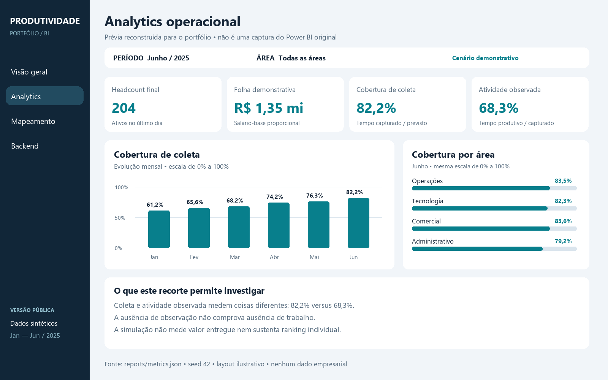
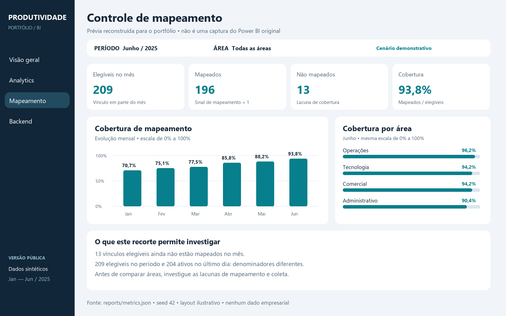
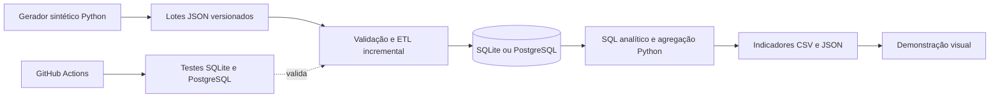

# Produtividade

### Analytics, controle de mapeamento e engenharia de dados

**Wenzel Lopes · Portfólio de Análise de Dados**

Como analisar a operação quando parte das pessoas ainda não está mapeada e a coleta não cobre toda a jornada? O projeto conecta **leitura de negócio, cobertura dos dados e uma base técnica auditável**.

[**Ver a galeria**](docs/galeria.md) · [**Explorar o backend**](docs/backend.md) · [**Entender a automação**](docs/automacao.md) · [**Executar o case**](docs/execucao.md)



> **Sobre as imagens:** prévias reconstruídas para o portfólio, com dados 100% sintéticos. Não são capturas do Power BI original. O projeto de referência foi inspecionado localmente; seus dados, conexões e código corporativo não estão neste repositório.

## O projeto em três frentes

| Frente | Pergunta de negócio | Evidência para explorar |
|---|---|---|
| **Analytics** | Quanto foi observado da operação e qual é a base da comparação? | [Leitura dos indicadores e recortes](docs/analytics.md) |
| **Mapeamento** | Quem está coberto e onde há lacunas antes de analisar atividade? | [Cobertura e denominadores](docs/mapeamento.md) |
| **Backend e automação** | Como carregar, corrigir e conferir os números sem duplicar dados? | [ETL, SQL, modelo e testes](docs/backend.md) |

## Conheça o BI de referência

O projeto Power BI fornecido para esta documentação contém **13 páginas, 125 medidas DAX e 38 relacionamentos**. São 47 tabelas, das quais 24 são calendários automáticos. Esses números descrevem o inventário local, não a quantidade de recursos implementados nesta demonstração pública.

As páginas incluem **Analytics Operacional, Analytics Comercial, Mapeamento, Visão Geral e Visão 360 Colaborador**, além de outras páginas e tooltips. A estrutura reúne Power Query, modelo semântico, medidas, navegação e papéis de segurança.

[Ver o mapa funcional do BI e o escopo público →](docs/projeto-bi.md)

## Controle de mapeamento antes da análise



Na amostra de junho, **196 de 209 vínculos elegíveis estão mapeados (93,8%)**. O headcount no último dia é 204: são populações diferentes. O projeto evidencia essa diferença em vez de usar um denominador único para todas as perguntas.

[Ver como interpretar cobertura, coleta e atividade →](docs/mapeamento.md)

## Do dado ao indicador



Este fluxo é a implementação pública reproduzível. O histórico do projeto de referência registra sincronização PostgreSQL com Python, reprocessamento por janela temporal e migração para VM. [Veja a experiência, as evidências e os limites](docs/automacao.md#experiência-de-automação-do-projeto-de-referência).

| Competência demonstrada | Onde conferir no código |
|---|---|
| Modelagem e integridade | [DDL, chaves e restrições](sql/001_schema.sql) |
| Carga incremental e correções | [ETL com controle de versões](produtividade/etl.py) |
| Auditoria e reprocessamento | [Tabela etl_batches](sql/001_schema.sql) e [testes](tests/test_pipeline.py) |
| SQL analítico | [View de indicadores PostgreSQL](sql/002_kpis_postgresql.sql) |
| Consistência dos cálculos | [Agregação Python](produtividade/analyze.py) |
| Integração contínua | [Workflow com PostgreSQL 16](.github/workflows/tests.yml) |

**Validação:** nove testes aprovados, incluindo reconciliação SQL × Python em PostgreSQL. [Consultar execução](https://github.com/Wenzel-Lopes/Produtividade/actions/runs/38105245050).

## Como avaliar este portfólio

- **Em 2 minutos:** percorra as imagens e leia as três perguntas de negócio.
- **Em 10 minutos:** abra o [backend](docs/backend.md), a [automação](docs/automacao.md) e o [dicionário de métricas](docs/metricas.md).
- **Na entrevista:** peça para demonstrar uma correção retroativa, explicar o denominador da cobertura e justificar a diferença entre atividade observada e resultado de negócio.

## Como abrir a demonstração

**Sem instalar ferramentas:** use **Code → Download ZIP**, extraia o pacote e abra `site/index.html`. Os filtros de mês e área funcionam com a amostra já incluída. Essa é uma demonstração HTML, não o Power BI original.

**Para reproduzir o backend**, com Python 3.10 ou superior:

```powershell
git clone https://github.com/Wenzel-Lopes/Produtividade.git
cd Produtividade
python -m produtividade demo
python -m unittest discover -s tests -v
```

[Instruções completas, inclusive PostgreSQL →](docs/execucao.md)

## Materiais e limites

[Apresentação executiva](docs/Produtividade-Portfolio.pptx) · [Resultados da simulação](docs/resultados.md) · [Guia de Power BI](docs/power-bi.md) · [Roteiro da entrevista](docs/entrevista.md)

O PBIP empresarial e seu cache não são distribuídos. Ainda não há um PBIX público nem um link de Power BI interativo. As imagens são reconstruções ilustrativas baseadas nos agregados de `reports/metrics.json`; não reproduzem todas as funcionalidades do relatório de referência. Analytics comercial, visão individual e regras corporativas não foram implementados na amostra pública. Os números simulados não representam ganhos reais, e a autoria de cada componente profissional não é presumida.
