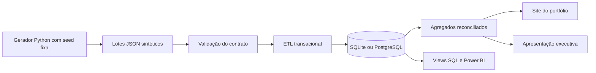

# Arquitetura e decisões

## Incremental por lotes e versões

O primeiro lote contém dimensões e fatos de janeiro a maio. O segundo traz junho e uma correção de março. O cadastro é um snapshot com estado conhecido em julho, portanto esta é uma análise retrospectiva, não uma previsão com informações disponíveis em cada mês.

Não usamos somente `MAX(data_do_fato)` para capturar novidades: isso perderia a correção retroativa. A seleção é por lote ainda não carregado e a precedência por `updated_at`. Em extração real, substituir os arquivos por CDC ou watermark de atualização com janela de sobreposição e reconciliação periódica.

O ETL inicia transação, serializa a escrita, consulta o histórico de lotes, valida chaves e tipos, insere/atualiza dimensões e fatos e grava o recibo. Erros desfazem a transação inteira. Repetir o mesmo arquivo não altera as tabelas; modificar um arquivo já aceito falha; uma nova versão usa outro nome de lote. Versões antigas não sobrescrevem versões novas. Mesma chave e timestamp com valores divergentes falham.

## Qualidade

Chaves duplicadas no lote são rejeitadas. Chaves estrangeiras e CHECKs protegem o banco. A validação verifica datas canônicas, primeiro dia do mês, timestamps UTC e vínculo temporal. Testes reconciliam salário agregado e equação de headcount. Valores ausentes por divisão por zero permanecem nulos.

## Limites intencionais

- Dimensões tipo 1, sem histórico de transferências ou salários. Em produção, implementar dimensão histórica tipo 2 e regra de alocação temporal.
- Sem hard delete/CDC de exclusão: encerramento do vínculo é um evento de negócio.
- Não há aplicação de regras reais de folha nem benchmark de produtividade.
- O gerador e ETL processam os lotes em memória; não são uma solução de grande escala.
- Um lock serializa as cargas. Em produção, avaliar particionamento, staging, COPY e merge por conjunto.
- Não há agendador implantado, RLS configurada, monitoramento externo ou SLA de produção. Ações CI testam o projeto ao publicar no GitHub.
- Dados de demonstração congelados em 2025; a data atual do computador não muda o cenário.

## Confidencialidade e autoria

Nenhum arquivo, código, medida, imagem ou registro do workspace empresarial é utilizado como entrada. A estrutura é uma implementação nova de problemas genéricos observados. A seed e os parâmetros são pedagógicos, sem ajuste às distribuições reais. Os sites e apresentações recebem apenas agregados sintéticos. Evite adicionar dados reais ao repositório. A descrição da contribuição em projetos anteriores exige confirmação pessoal do autor.
