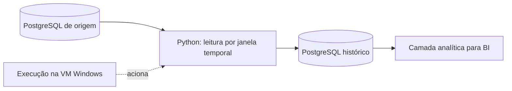

# Automação dos bancos e validação

## O que está implementado publicamente

O comando `python -m produtividade demo` encadeia geração, carga dos lotes e exportação. Para PostgreSQL, utiliza-se `--postgres` e `DATABASE_URL`. Os lotes já processados não duplicam registros. As instruções completas estão no [guia de execução](execucao.md).

O [GitHub Actions](../.github/workflows/tests.yml) dispara em push e pull request, sobe PostgreSQL 16, instala o driver, executa testes SQLite/PostgreSQL e roda o cenário demonstrativo. Esse banco é temporário para CI; o workflow não atualiza um banco de produção nem um relatório no Power BI Service.

[Ver execução aprovada com nove testes](https://github.com/Wenzel-Lopes/Produtividade/actions/runs/38105245050).

## Separar automação de carga de agendamento

| Capacidade | Estado |
|---|---|
| Geração → carga → exportação por comando | Implementada |
| Reprocessamento sem duplicidade | Implementado e testado |
| Correção retroativa com versões | Implementada e testada |
| Testes automáticos em PostgreSQL | Implementados no GitHub Actions |
| Agendamento diário de produção | Não configurado neste repositório |
| Extração de bases empresariais | Não publicada |
| Atualização automática do Power BI Service | Não configurada |
| Alertas, retentativas e monitoramento operacional | Não implementados |

## Experiência de automação do projeto de referência

O histórico de desenvolvimento registra sincronização entre bancos PostgreSQL com Python. O responsável confirmou uma execução concluída com reprocessamento por janela de datas e posteriormente relatou a migração do script para uma máquina virtual. Uma conversa posterior registra uma tarefa travada após troca de credenciais; a causa foi levantada como hipótese, sem resolução comprovada no trecho consultado.

A janela de sete dias aparece na execução relatada. O histórico contém orientação para usar o Agendador de Tarefas do Windows; a frequência efetivamente configurada e o estado atual do agendamento não foram verificados. A ligação final entre o banco e o refresh do relatório também precisa de validação no ambiente de trabalho.

### Decisões e aprendizado técnico

- Reprocessamento temporal para acomodar alterações recentes e preservar o histórico anterior.
- Investigação de identificadores da origem e geração de chaves no destino.
- Separação entre teste manual do script e execução sob a identidade da tarefa agendada.
- Logs para acompanhar etapas e diagnosticar execução.

O código discutido no histórico separava a exclusão da janela e a inserção em transações diferentes. Isso cria risco de lacuna se a escrita falhar. Para uma evolução de produção, o desenho deve considerar estágio de carga, validação antes da substituição, transação atômica, controle de concorrência e recuperação após indisponibilidade maior que a janela. Não se afirma que essas melhorias já foram implantadas.

### O que esta evidência comprova

Comprova o relato de execução e a discussão técnica. Não constitui auditoria do ambiente empresarial nem comprova SLA, ganho financeiro, agendamento atual ou atualização automática do Power BI. Código, nomes de usuários, endereços, volumes internos e logs completos não são publicados.
