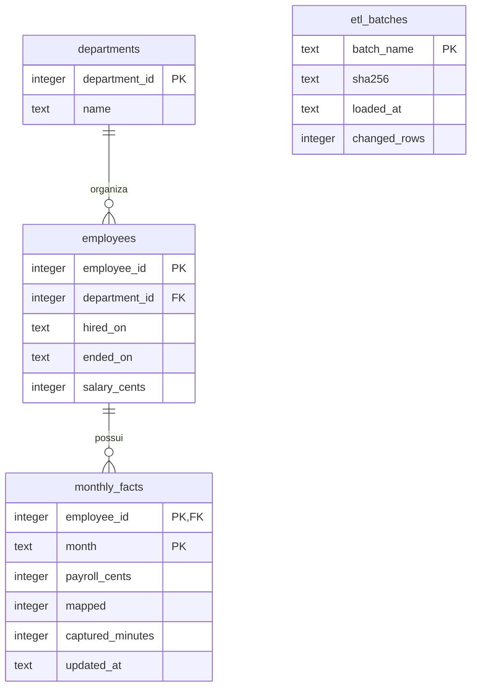

# Backend: modelo, carga e rastreabilidade

Esta documentação descreve **o código demonstrativo deste repositório**. A estrutura técnica empresarial não foi copiada.

`etl_batches` é uma tabela de auditoria por arquivo, sem chave estrangeira para os fatos. O grão de `monthly_facts` é pessoa × mês. Dinheiro é armazenado em centavos inteiros; datas são strings ISO validadas na carga. A estrutura simplifica mobilidade de pessoas: não implementa histórico de transferência entre áreas.

## Uma correção chega sem duplicar a base

1. O gerador cria 240 vínculos fictícios e 1.272 fatos mensais.
2. O ETL valida estrutura, datas, chaves e versões do lote.
3. Nome do lote e SHA-256 distinguem repetição de alteração indevida.
4. Upserts aceitam versões mais novas; versões antigas não substituem o estado atual.
5. Versões iguais com conteúdos diferentes geram conflito e rollback.
6. Junho chega junto com uma correção de R$ 150 em março.
7. SQL e Python recompõem os indicadores e os testes verificam sua consistência.

O incremental é por lotes e versões de registros; não é CDC de banco. O banco usa transações; a implementação PostgreSQL utiliza bloqueio transacional para serializar a carga.

## Revisão guiada do código

| Arquivo | O que inspecionar |
|---|---|
| [generate.py](../produtividade/generate.py) | Reprodutibilidade e cenário da correção |
| [db.py](../produtividade/db.py) | Conexão, parâmetros e diferenças entre motores |
| [etl.py](../produtividade/etl.py) | Validações, idempotência e rollback |
| [001_schema.sql](../sql/001_schema.sql) | Chaves, CHECKs e índice |
| [002_kpis_postgresql.sql](../sql/002_kpis_postgresql.sql) | Agregações e view analítica |
| [analyze.py](../produtividade/analyze.py) | Denominadores e exportação |
| [test_pipeline.py](../tests/test_pipeline.py) | Casos de falha e reconciliação |

[Execução passo a passo](execucao.md) · [Automação e limites](automacao.md)
